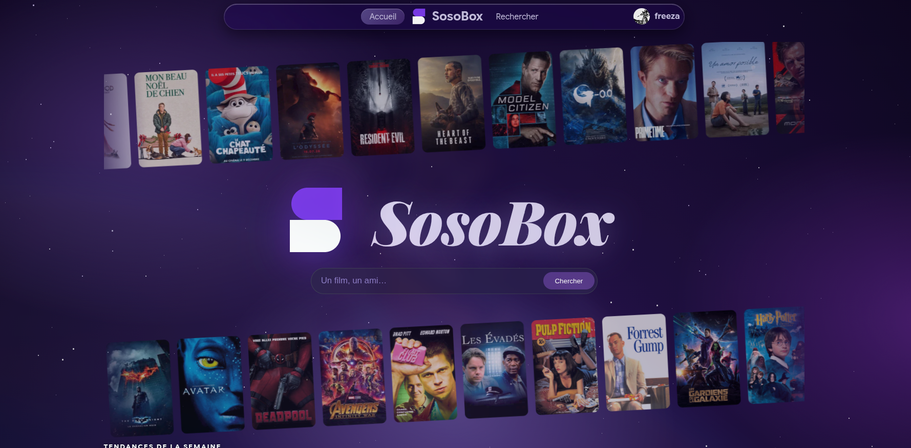
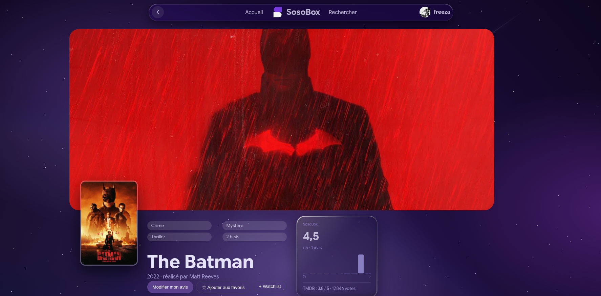
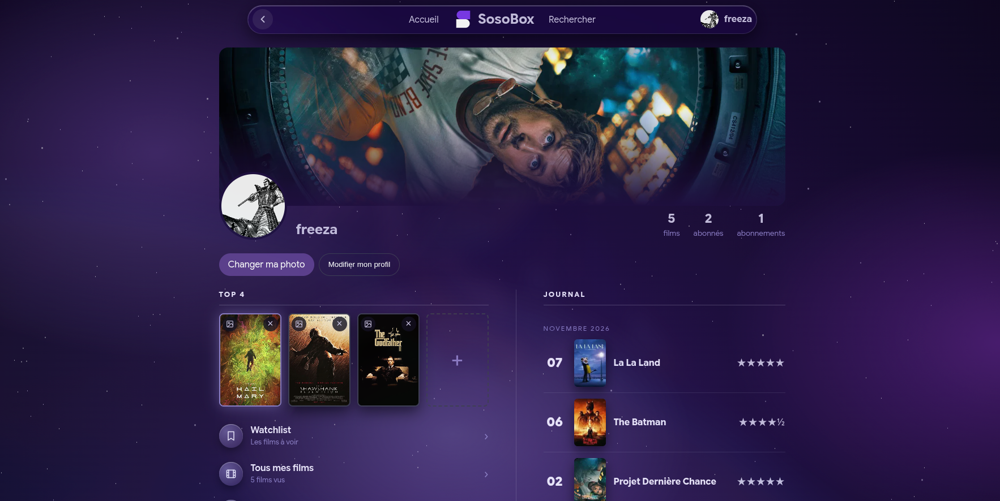
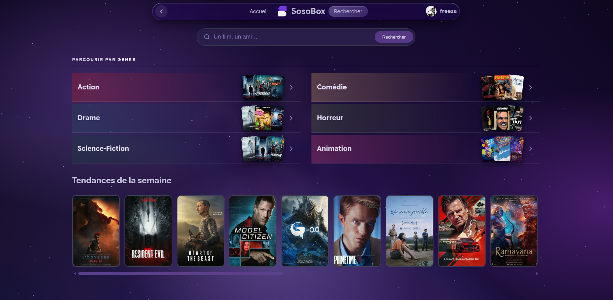
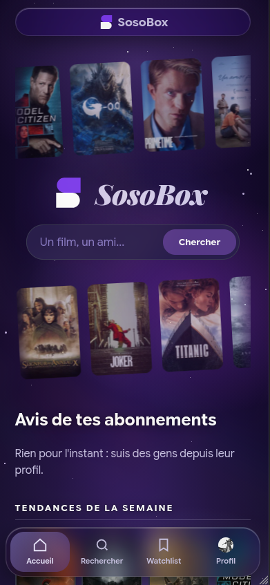

# SosoBox

Mon Letterboxd perso : je note les films que je vois, j'écris ce que j'en ai pensé, et je suis ce que regardent mes amis.

**https://sosobox.duckdns.org**

C'est un projet perso, sans but commercial, que j'ai construit pour apprendre le web en partant du C.



## Ce qu'on peut y faire

**Les films**

- Noter un film de ½ à 5 étoiles, avec une critique et la date où on l'a vu
- Voir sur la fiche d'un film sa note moyenne, la répartition des notes et ce qu'en ont pensé ses amis
- Garder une liste de films à voir

**Trouver quoi regarder**

- Un accueil avec deux bandes d'affiches qui défilent, puis les tendances, les films au cinéma, les mieux notés et les plus vus sur SosoBox
- Parcourir par genre : action, comédie, drame, horreur, science-fiction, animation, avec les classiques les plus votés de chacun
- Une recherche qui propose des films et des amis dès les premières lettres

**Son profil**

- Choisir ses 4 films préférés, les réordonner en les glissant, et choisir l'affiche de chacun parmi celles qui existent
- Un journal des films vus, rangé par mois
- Ses stats : moyenne, notes les plus données, films vus par année

**Les amis**

- Suivre ses amis et voir leurs avis sur l'accueil
- Voir qui on suit et qui nous suit, et suivre quelqu'un en un clic

Le tout marche aussi bien sur téléphone que sur ordinateur, et on peut rester connecté 30 jours.

## En images

| Une fiche film | Un profil |
| --- | --- |
|  |  |

| La recherche par genre | Sur téléphone |
| --- | --- |
|  |  |

## En dessous

Node.js, Express, EJS, SQLite et du CSS fait main. Les infos des films viennent de l'API TMDB.

Quelques détails dont je suis content :

- les sessions sont rangées dans SQLite, donc une mise à jour du site ne déconnecte personne ;
- les mots de passe sont chiffrés avec bcrypt, et la connexion se bloque après 5 essais ratés ;
- les films pour adultes sont filtrés partout ;
- le ciel étoilé du fond est fait en CSS, sans image.

## Le lancer chez soi

```bash
git clone git@github.com:Freeza222/SosoBox.git
cd SosoBox
npm install
```

Crée un fichier `.env` avec ta clé TMDB (gratuite sur [themoviedb.org](https://www.themoviedb.org/settings/api)) et un secret de session :

```
TMDB_TOKEN=ta_cle_tmdb
SESSION_SECRET=une_longue_chaine_au_hasard
```

Puis `npm run dev` et direction <http://localhost:3000>.

## En ligne

Le site tourne sur un petit serveur Ubuntu (Azure for Students), derrière Caddy pour le HTTPS. La base est sauvegardée chaque nuit.

Pour mettre à jour après un `git push` :

```bash
ssh ubuntu@<IP_DU_SERVEUR> 'cd ~/SosoBox && git pull && npm ci --omit=dev && sudo systemctl restart sosobox'
```

## Merci

À [TMDB](https://www.themoviedb.org/) pour les données des films. Ce produit utilise l'API TMDB, mais il n'est ni approuvé ni certifié par TMDB.
